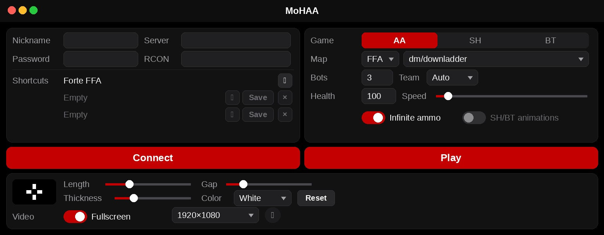

# moh-launcher

macOS launcher for OpenMoHAA.

Connect opens `openmohaa.app`. Play opens `mohbots.app`.

Download [launcher-macos-arm64.zip](https://github.com/pstngh/moh-launcher/releases/download/v2.0/launcher-macos-arm64.zip) (Apple silicon, macOS 15 or later). Unzip `launcher.app` into the game folder, next to `openmohaa.app` and `mohbots.app`.

`./bundle.sh` builds `launcher.app` in the current folder.
